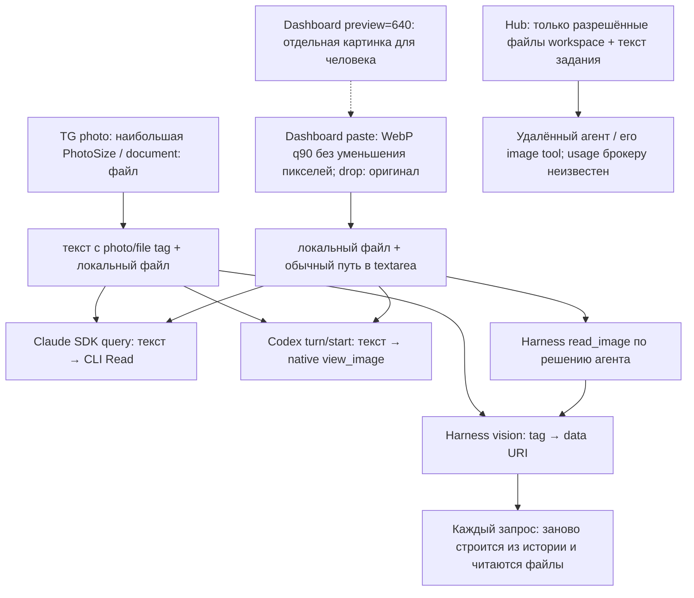

# V-1070 — изображения Orchestra: применимость и границы экономии

**RESEARCH DONE · 24.10.2026 · только исследование.** Продукт, конфиги, prompts,
skills и правила не менялись. Таблицы ниже — факты и условия для решения root;
они не являются решением о внедрении.

Численная экономия реальной подписочной квоты **не установлена**. Для нашего
контрольного набора из 12 изображений 1280×720 расчёт Claude даёт 14 352 visual
tokens. Три листа 1568×886 дают 5 376 на high-resolution tier или 4 680 на
standard tier, с уменьшением каждого оригинала примерно до 780×439 или ещё
меньше. Три листа 2560×1440 с исходным размером ячеек дают на high tier те же
14 352. Это расчёт входных патчей, не usage замер. Подробности и первичные
формулы — таблица 4; качество и дочитывания — таблицы 3 и 5.

## 1. Маршруты в выданном коде

Граница покрытия: прочитана предоставленная копия исходников; живое состояние,
приватная активность, версии/настройки установленных на production CLI не
проверялись. Ссылки `app/...:строки` относятся к этой копии; хеши основных
файлов — [code-manifest.json](code-manifest.json), дословные выдержки —
[logs/code-excerpts.txt](logs/code-excerpts.txt). Наличие обработки в исходнике
не доказывает её запуск в конкретном живом процессе.

| Маршрут / модели | Входная поверхность | Фактическая обработка и ресайз на видимой границе | Повторное чтение / восстановление | Usage доступен? | Код и строки |
|---|---|---|---|---|---|
| TG → любой backend | `photo`, `document`, несколько сообщений рядом | Photo: `msg.photo[-1]`, то есть уже предоставленная Telegram версия; исходные пиксели камеры не доказаны. Document: скачанные байты файла. Локального OCR/поворота/листа здесь нет | Кеш по `file_unique_id` исключает повторное скачивание, если файл ещё существует; это не кеш vision-токенов. Debounce объединяет доставку текста, а не растровые листы | На TG границе нет model usage | `app/tg_bridge.py:264–295, 429–457, 614–633, 4405–4428` |
| Dashboard paste → любой backend | Clipboard image → `/api/upload` → текст сообщения | От 100 KiB пытается WebP q0.9 в исходной ширине/высоте; принимает только меньший blob. Это кодек, не уменьшение разрешения. Меньше порога/ошибка/невыгодно: оригинал | Upload по MD5 имени не перезаписывает существующий файл. В textarea вставляется обычный путь; это не multipart image backend | На upload границе нет | `app/static/js/chat.js:740–841`; `app/static/js/app.js:2144–2160`; `app/routes/tg.py:285–300` |
| Dashboard drop / file upload → любой backend | Выбранный пользователем файл | Drop идёт без clipboard WebP-компрессии; сервер сохраняет полученные байты, ограничивает размер/расширения | Повторная загрузка тех же байтов не равна повторной оплате или её отсутствию; это разные слои | Нет | `app/static/js/app.js:2163–2177`; `app/routes/tg.py:285–315` |
| Claude SDK: Fable 5.1, Opus/Sonnet/Haiku 5.5, Opus 4.6 `[1m]` | TG tags, dashboard путь, workspace файл через CLI Read | `query(message)` передаёт **строку**. В Orchestra нет общего image normalizer/resizer. Фактическое встраивание изображения и preprocessing принадлежат CLI; его реализация здесь не измерялась. Публичные API tiers — таблица 4 | CLI ведёт native историю; существование прежнего результата/попадание в cache/повторный Read нельзя выводить из одного пути. SDK session resume не является замером image reread | Есть общие input/output/cache creation/cache read по сообщениям/результату; image-only поля в нормализованном контракте нет | `app/backend_claude.py:1361–1366, 1724–1759, 1791–1805, 1977–2020`; `app/models.py:68–105`; `app/usage_contract.py:28–53` |
| Codex app-server: GPT-6 Luna, GPT-6.1 Sol, GPT-6 Astra; Spark остался в исходном каталоге | Те же пути в тексте → native `view_image` / UI имя `ViewImage` | `turn/start`/`turn/steer` получают только `type:text`; нет автоматической отправки `localImage` в этой функции. Пиксели/native image resize/detail — вне этого Python backend и здесь неизвестны. Spark по текущим публичным docs retired, фактическим действующим vision-путём его не считаем | Native tool вызывается по поведению агента. Его повторные чтения/компактация/кеш не замерены | Есть total/last input, cached input, output и delta хода; отдельного image usage нет. Cached input уже входит в native input | `app/backend_codex.py:782–825, 1345–1354, 1939–1988, 2023–2036`; `app/models.py:108–129` |
| Hub Claude Haiku/Sonnet/Opus 5.5; Hub GPT-6 Luna/Sol; также Hub Grok 4.7 | Текст + копия файлов workspace | Маппинг на удалённые провайдеры; scope, regular files, размер и publication guard описывают **намерение кода ограничить upload**, не гарантию исключения ПД или приватных данных: автоматически добавляемые корневые файлы могут содержать приватные сведения организации. Внешний TG/dashboard абсолютный путь сам по себе не переносит файл. Отдельной image-attachment конверсии в брокере нет | Файлы синхронизируются по manifest; чтение изображения внутри удалённого агента независимо от upload. Приватные изображения на hub для этого опыта не передавались | **Брокер не получает token usage**; `billing_mode=free`, cost 0 относятся к учёту брокера, а не к нулевой работе vision | `app/backend_hub.py:33–39, 484–519, 636–646, 856–886`; `app/hub_workspace.py:352–410` |
| OpenRouter Harness: только route с `image` input + tools | TG `[photo:...]` / `[file:...]`; workspace `read_image` | Валидирует PNG/JPEG/WebP/GIF и границы пути; 20 MiB файл и суммарные inline bytes запроса. Отправляет исходные байты в data URI, `detail` не указан. Нет EXIF transpose/resize/OCR. Provider-specific обработка дальше неизвестна | `_prepare_messages` **каждый запрос** обходит историю и читает прежние файлы заново; workspace tool result вновь превращается в user image. Проверено offline: 2 tagged + 2 workspace запроса, 4 чтения, байты идентичны. Исчезнувший файл даёт ValueError | Provider usage сохраняется, запрашивается include usage; нормализуются prompt/completion/cache/cost, но image-only разбивка не используется | `app/harness/llm.py:397–465, 478–485, 520, 654–692`; `app/harness/images.py:8–59`; `app/backend_harness.py:391–419, 430–488` |
| OpenRouter Harness: dashboard обычный путь / text-only route | Вставленный путь, либо route без image capability | Обычный путь **не совпадает** с image tag: остаётся текстом; может понадобиться `read_image`. При отсутствии image capability tags тоже остаются текстом, `read_image` скрыт. Нельзя считать каждый upload vision-input | Сохранённые текстовые ссылки не содержат base64; отсутствие файла ломает последующее vision-разворачивание, а не восстанавливает изображение из БД | Общие usage, когда провайдер прислал; image по одному upload не атрибутируется | `app/harness/llm.py:398–400, 453–464`; `app/harness/tools.py:248–252, 459, 483–489`; `app/backend_harness.py:159–162`; offline [probe stdout](logs/boundary-probe-stdout.txt) |
| OpenRouter one-shot, стандартное создание клиента | Строковый prompt в `run_oneshot` | Создаёт OpenRouterClient с supported_parameters, **без input_modalities/workspace_root**. Default input_modalities пуст: `_prepare_messages` оставляет текст. Нельзя переносить vision-возможность session backend на этот entrypoint; инъекция своего llm — отдельный случай | Временная AgentLoop history; возможные file tags не превращаются в images при этом default. Живой one-shot не запускался | Возвращает суммарные input/output и cost из round_usages, без image breakdown | `app/harness/oneshot.py:18–40, 53–79`; `app/harness/llm.py:357–370, 397–400`; `app/harness/loop.py:521` |
| Harness MCP image result | Возврат content block `type:image` внешним MCP | `_extract_text` сводит non-text block к маркеру `[image]`, не data URI. Для просмотра workspace файла существует отдельный `read_image` путь выше | Сам image payload не сохраняется этим текстовым результатом и из маркера не восстанавливается | Отдельного image usage на этом мосте нет | `app/harness/mcp.py:323–343` |
| `codex_review` / exec / resume через CLI | Текст prompt через stdin, файлы worktree | Строит `codex ... exec/review/resume ... - < prompt_file`; автоматических image аргументов в этой сборке команды нет. Чтение файла native tool остаётся внутри CLI | Resume либо fresh fallback; какие изображения реально перечитываются, неизвестно | Есть путь регистрации usage_event; image breakdown в этом entrypoint не установлен | `app/mcp_stdio.py:4484–4556, 4617–4629` |
| Dashboard просмотр результата Read/ViewImage | `/api/files/raw?...&preview=640`, image cards/overlay | Для человека: EXIF transpose, JPEG draft, LANCZOS thumbnail, WebP q82, edge clamp 64…1600, LRU 256 с mtime/size. Без preview/download — исходный файл. **Эти пиксели не подменяют автоматически image tool model input** | Browser/серверный preview кеш экономит повторную отдачу, не доказывает provider cache hit | Нет model usage на просмотр | `app/routes/system.py:281–307, 324–365`; `app/static/js/chat.js:1090–1092, 3669–3677, 3964–4003` |
| Hub image generation MCP | Запрос рисования → отдельный hub Sol producer | Это генерация, не входной OCR/vision normalizer. Не вызывалась в исследовании | Отдельный lifecycle generated images; не подтверждает поведение чтения фото | Не использована для измерения | `app/hub_image_mcp.py:21`; `app/hub_image.py:191–214, 264–290` |

Точные selectable модели — исходный `app/models.py`, а OpenRouter меняется по
публичному каталогу. Наш read-only GET обнаружил **20 routes**, удовлетворяющих
текущему allow-rule+text/tools, из них **10 с image input**. Это предложение
публичного провайдера, не список включённых в приватной Orchestra моделей.
[Полный сокращённый снимок](public-routes.json) включает и десять text-only routes.
Image routes: `nvidia/nemotron-3.5-super-vl:free`,
`dots-studio/dots-3-note-preview:free`, `thinkingmachines/inkling-small:free`,
`thinkingmachines/inkling:free`, `nvidia/nemotron-3-nano-omni-30b-a3b-reasoning:free`,
`google/gemma-4-26b-a4b-it:free`, `google/gemma-4-31b-it:free`,
`deepseek/deepseek-v4.1-flash`, `deepseek/deepseek-v4.1-flash-1017`,
`z-ai/glm-5.3-flash`. Последние три — из уже существующего paid allowlist;
никакой из них не вызывался. `z-ai/glm-5.3` в снимке text-only.
Критерии: `app/model_catalog.py:35–84`; allowlist `app/models.py:536–545`.
Модельные размеры/цены и pipeline activation из приватного каталога не читались.
[Текущие официальные Codex models](https://learn.chatgpt.com/docs/models?surface=web)
помечают Spark retired с14.09.2026; наличие ID в нашем исходном каталоге не
подтверждает его доступность. Это расхождение зафиксировано без продуктовой правки.
[OpenRouter Image Inputs](https://openrouter.ai/docs/guides/overview/multimodal/image-understanding)
подтверждает multipart data URI и зависимость лимитов от модели/провайдера.

## 2. Техники: кандидаты и условия применимости

«Уже есть» означает видимый код выданной копии, не production verification.
Числа собственного опыта не заимствованы из vendor accuracy.

| Техника / первичный источник | Механизм / уже есть? | Ограничение и конкретное условие применимости | Локальный опыт + N | CPU / диск / качество | Что неизвестно |
|---|---|---|---|---|---|
| EXIF transpose, Pillow [docs](https://pillow.readthedocs.io/en/stable/reference/ImageOps.html#PIL.ImageOps.exif_transpose) | Нормализует orientation metadata; уже есть в **dashboard preview**, не в общей model input границе | Только при достоверном EXIF tag; не определяет физически перевёрнутую PNG без metadata. Повторно применять тег к уже нормализованным пикселям нельзя | Один собственный JPEG, tag=6, 720×1280 → 1280×720; после transpose tag удалён; визуально upright | Отдельный timing transpose не измерен; одно декодирование/сохранение. Детали №9 визуально сохранены, JPEG уже lossy | Как каждый TG/CLI путь обрабатывает EXIF; частота таких файлов |
| OCR vote 0/90/180/270, Tesseract [command reference](https://tesseract-ocr.github.io/tessdoc/Command-Line-Usage.html), [engine repo](https://github.com/tesseract-ocr/tesseract) | OCR четырёх вариантов, score/gates выбирают поворот; в Orchestra не найдено | Имеет смысл на текстовых страницах при доказанном преимуществе правильного угла. Для графика без текста/смешанных углов безопасного победителя может не быть. `rus+eng` требует обеих моделей | **N=0**: `tesseract --version` → command not found. Четыре геометрических поворота на трёх originals проверены отдельно, без OCR | CPU/память/accuracy OCR неизвестны. Четыре engine runs и 2× upscale нельзя оценивать одним classifier timing | Пороги Кеши, psm11, язык, параллельность, 40s timeout на нашей нагрузке не воспроизведены |
| PP-LCNet_x1_0_doc_ori, [PaddleOCR docs](https://www.paddleocr.ai/main/en/version3.x/module_usage/doc_img_orientation_classification.html), [repo](https://github.com/PaddlePaddle/PaddleOCR/blob/main/docs/version3.x/module_usage/doc_img_orientation_classification.en.md) | Классифицирует всю страницу на 4 угла; отдельная задача от распознавания строк и исправления perspective. В продукте нет | Документная направленность не гарантирует поведение на терминале/схеме; score требует локальной калибровки | **N=0 для точных текущих весов PaddleOCR**. Нельзя приписать этому checkpoint результаты другого wheel | Не измерено локально; модель/engine отдельно не ставились. Vendor N=1000 и CPU/GPU цифры не используются как наша производительность | Совпадение весов с Rapid/Kesha, перенос на screenshots, blank/OOD |
| `rapid-orientation==0.0.11`, [repo](https://github.com/RapidAI/RapidOrientation), [main.py](https://github.com/RapidAI/RapidOrientation/blob/main/rapid_orientation/main.py) | Local ONNX; short side256 → center224 → 3 **идентичных** crop → argmax majority. Продуктом не используется; публичный callable возвращает label/time, не confidence | На наших простых текстовых synthetic работает; gate .95 не доказан как полезный. Provenance модели — ранний PaddleClas, идентичность современному doc_ori не установлена | 3 исходных макета × 4 угла =12 cases, по3 вызова (36), ещё1 blank. Pixel recovery12/12; blank не имеет правильного угла. Все12 crop-triplets идентичны | median21.87ms wall /28.02ms CPU на вызов; init41.31ms; peak RSS141.7MiB; ONNX6 783 084B. Scores .793… .928; при p≥.95, margin≥.80 принято **0/12** | Не независимая выборка фото; не calibrated probability. Полная связка OCR→fallback и холодный старт ОС не измерены |
| Contact sheet 2×2 с номером → исходник, наш [experiment.py](experiment.py), бюджеты — official vision docs ниже | Обзор нескольких кадров одним изображением; в продуктовых входных путях не найдено. Номер+JSON позволяет запросить исходник, но не принуждает агента сделать это | Для общего расположения/типов/крупных статусов; при обязательных мелких ID/координатах нужны original/ROI. Уменьшение, нумерация и многоизображённый порядок могут влиять на качество | N=12 synthetic, 3 sheets ×3 размера; семантический обзор12 элементов, точные поля3 представителей | Compact3 sheets:339.36ms CPU/340.63ms wall;329 688B против371 338B12 PNG. Full:275.18ms CPU/225 448B; half:280.93ms CPU/222 000B. Encoder проход единичный; общий image-process RSS101.3MiB | Agent compliance, rereads, парные ошибки model, выигрыш квоты, реальная доля пачек |
| Resize / crop ROI / оставить исходник, [Anthropic coordinates](https://platform.claude.com/docs/en/build-with-claude/vision-coordinates), [OpenAI vision](https://developers.openai.com/api/docs/guides/images-vision) | Меньше патчей или больше разрешение нужного поля; в общей input-границе Orchestra нет, dashboard thumbnail только presentation | ROI применим, если область заранее известна и сохранён контекст/offset; нет гарантии сохранения остальных значимых областей. Оставить исходник при неуверенности сохраняет исходные данные, но не исправляет его поворот | Resize — те же12 synthetic; lossless inverse rotations12/12; ROI inference **N=0** | Размер текста10px →6.09px в compact или5px half. Это физическая потеря разрешения; перенос координат обязателен. CPU resize включён в sheet timings | Покрытие ROI и missed fields на реальных screenshots; стоимость выбора областей |
| PNG→WebP q90 без resize, Pillow [format docs](https://pillow.readthedocs.io/en/stable/handbook/image-file-formats.html#webp) | Уменьшает bytes, **не число патчей** при тех же pixels; clipboard аналог уже есть | Может помогать upload, если encode+channel дешевле передачи исходника; lossy мелкий текст проверяется отдельно | 3 originals encoded, №9 осмотрен семантически; browser encoder не запускался | PNG→WebP:32 963→22 726B;28 283→24 082B;31 396→22 482B; CPU64.49/53.81/43.38ms. Все1280×720; №9 layout/date/status/ID приняты без ошибки при неслепом чтении | Наши PNG все меньше100KiB: нынешний clipboard gate их вообще пропустит. Нет browser timing и сети владельца; image-token эффект при неизменных pixels расчётно0 |

Лицензии изученного кода проверены отдельно по первоисточникам:

| Проект / версия | Лицензия кода и первичный источник | Что сохранено в артефактах |
|---|---|---|
| rapid-orientation 0.0.11 | Apache-2.0: [метаданные конкретного релиза](https://pypi.org/project/rapid-orientation/0.0.11/) и LICENSE внутри его wheel | Полный [LICENSE из wheel](sources/licenses/rapid-0.0.11-LICENSE), metadata header, исходные авторские заголовки и ссылки атрибуции во всех скопированных Rapid-файлах; совпадение четырёх версионных файлов с wheel проверено |
| PaddleOCR | Apache-2.0: [LICENSE репозитория](https://github.com/PaddlePaddle/PaddleOCR/blob/main/LICENSE) | [Полный текст](sources/licenses/PaddleOCR-LICENSE) и URL/хеш источника |
| Tesseract | Apache-2.0: [LICENSE репозитория](https://github.com/tesseract-ocr/tesseract/blob/main/LICENSE) | [Полный текст](sources/licenses/Tesseract-LICENSE) и URL/хеш источника |

[Сводка retained licenses/notices](sources/THIRD_PARTY_NOTICES.md) относится к
указанным копиям кода. Она **не объявляет документацию API, страницы моделей,
цены и прочие веб-источники Apache-2.0**. Отдельный upstream NOTICE не найден
в wheel Rapid 0.0.11; проверенный корневой NOTICE репозитория вернул 404.
Исходные заголовки/атрибуция сохранены, собственная сводка не выдаётся за upstream
NOTICE. Дополнение не включало установок или inference.

## 3. Сравнимые образцы и семантическая проверка

Собственный воспроизводимый корпус: 12 PNG по1280×720; три семейства с четырьмя
вариантами даты/status/ID. Это **синтетические приближения типов screenshots**,
не выборка фактического dashboard или приватных документов. Генератор не использует
image generation API. Эталон: [ground-truth.json](ground-truth.json); номер→original:
[sheet-map.json](sheet-map.json); SHA256 и размеры: [sample-manifest.json](sample-manifest.json).
Метод чтения и его неслепое ограничение — [method.md](method.md).

Для каждого представителя проверены три точных поля: Build16px, Date12px,
ID10px. Статус результата — **верно / неверно / не прочитано**. Неразличимые
O/0/I/1 не угадывались по известному эталону. Принятые строки и null-отказы —
[semantic-observations.json](semantic-observations.json). Это чтение самим
исследователем текущего хода; отдельный vision API или новый оценщик не запускался.

| Сравнимый образец | Пиксели до → после для одного элемента | Детали: верно / неверно / не прочитано | Обзор | Расчётные image tokens всей пачки12 на Claude high / standard | Граница вывода |
|---|---|---|---|---|---|
| [Terminal №1 original](samples/01-terminal.png), также ячейка [full](samples/sheet-1-full.png) | 1280×720 →1280×720 | 3/0/0: FAILED;2026-10-11;Q01-O0I1-B8S5 | Ошибка expected42/received43,1 failed/27 passed | Отдельные originals14 352/14 352;3 full-листа14 352/4 680 | На standard сервер уменьшит лист; native full preview исследователя не моделирует его качество |
| [Terminal compact](samples/sheet-1-compact.png), №1 | 1280×720 →780×439 | 2/0/1: статус/дата приняты, точный ID не принят | Ошибка и сводка тестов различимы | 5 376/4 680 | Нельзя выдавать весь мелкий текст за прочитанный |
| [Terminal half](samples/sheet-1-half.png), №1 | 1280×720 →640×360 | 2/0/1 | Общая ошибка/структура терминала различимы | 3 588/3 588 | У остальных типов мелких monospace возможны ошибки, а не только отказы |
| [Dashboard №5 original](samples/05-dashboard.png), также [full](samples/sheet-2-full.png) | 1280×720 →1280×720 | 3/0/0: FAILED;2026-10-15;Q05-O0I1-B8S5 | Queued18,Running4,Errors1; линия в целом растёт | 14 352/14 352 originals;14 352/4 680 full | Это макет, не данные приватной активности |
| [Dashboard compact](samples/sheet-2-compact.png), №5 | 1280×720 →780×439 | 2/0/1 | Все три крупных числа и направление линии сохранены | 5 376/4 680 | Крупный overview не доказывает чтение подписи мелкого графика/координаты кнопки |
| [Dashboard half](samples/sheet-2-half.png), №5 | 1280×720 →640×360 | 2/0/1 | Те же крупные числа и обзор | 3 588/3 588 | На более плотном настоящем UI вывод не проверен |
| [Document №9 original](samples/09-document.png), также [full](samples/sheet-3-full.png) | 1280×720 →1280×720 | 3/0/0: FAILED;2026-10-19;Q09-O0I1-B8S5 | Test sensor12 checked;Panel adapter03 pending | 14 352/14 352 originals;14 352/4 680 full | Плоский печатный макет; нет handwriting, perspective, бликов |
| [Document compact](samples/sheet-3-compact.png), №9 | 1280×720 →780×439 | 2/0/1 | Две строки таблицы, количества и состояния читаются | 5 376/4 680 | Отсутствие ошибок в принятых полях не равно perfect OCR: отказ от ID учитывается |
| [Document half](samples/sheet-3-half.png), №9 | 1280×720 →640×360 | 2/0/1 | Табличный обзор сохранён | 3 588/3 588 | Даже на чистом макете точный мелкий ID не принят |

Обзор просмотрен на всех12 элементах трёх full/compact/half-листов: типы
terminal/dashboard/document, порядок номеров и крупная структура сохраняются.
Точная аудируемая выборка — только9 полей у3 представителей на вариант;
считать это36 независимыми успешными OCR нельзя. Ошибок среди **принятых**9
original-полей не обнаружено; для compact/half принято по6, ещё3 поля оставлены
непрочитанными. Слепой контроль другим читателем не проводился.

## 4. Современные формулы и расчёт границ

На дату чтения [Anthropic Vision](https://platform.claude.com/docs/en/build-with-claude/vision)
описывает28×28 patches: `ceil(w/28)*ceil(h/28)`. Standard: edge1568/budget1568;
Claude4.7+ high: edge2576/budget4784. Оба ограничения применяются одновременно.
[Точная геометрия](https://platform.claude.com/docs/en/build-with-claude/vision-coordinates)
учитывает округление/padding; наша функция воспроизводит приведённые там размеры.
Избирательное применение этих публичных API tiers к **CLI** всё ещё требует
проверки фактического image result/request. Модели5.x в каталоге соответствуют
high по общей таблице; Opus4.6 — standard.

[Official OpenAI vision documentation](https://developers.openai.com/api/docs/guides/images-vision)
даёт Astra32×32 patches×1.2 с округлением вверх: `original/auto` сохраняет
наши размеры, `high` ограничен2500 patches, `low` —512×512. После shrink
учитывается целочисленное покрытие. Для **GPT-6 Luna и GPT-6.1 Sol** их
[официальные](https://developers.openai.com/api/docs/models/gpt-6-luna)
[страницы](https://developers.openai.com/api/docs/models/gpt-6.1-sol)
подтверждают image input, но конкретной строки image-sizing/multiplier для
этих ID в прочитанной таблице нет. Подменять её Astra или GPT-5.6 нельзя.

| Сравнение одной и той же пачки | До → после (файлы/pixels) | Claude high, до→после | Claude standard, до→после | Astra API original / high, до→после | Что именно уменьшено |
|---|---|---|---|---|---|
| Четыре originals на full-лист | 12×1280×720 →3×2560×1440 | 14 352→14 352 (0%) | 14 352→4 680 (−67.39%) | 13 248→12 960 (−2.17%) /8 793 (−33.63%) | В high-Claude почти только число файлов; standard/Astra high уменьшают сам лист |
| Compact с полями как у Кеши | 12×1280×720 →3×1568×886; ячейка780×439+gap | 14 352→5 376 (−62.54%) | 14 352→4 680 (−67.39%) | 13 248→4 941 (−62.70%) /4 941 | Сначала уменьшается каждый screenshot, затем standard ещё уменьшает лист до1456×823 |
| Half | 12×1280×720 →3×1280×720; ячейка640×360 | 14 352→3 588 (−75%) | То же | 13 248→3 312 (−75%) /3 312 | Вдвое меньше ширина/высота каждого элемента |
| Square stress case, геометрия без визуального quality опыта | 12×1280×720 →3×1568×1568 | 14 352→9 408 | 14 352→4 563, размер1092×1092 | 13 248→8 646 /8 646 | У square свой budget; пустые поля тоже покрываются patches |
| Только поворот90° | 1280×720 →720×1280 | 1 196→1 196 | 1 196→1 196 | 1 104→1 104 /1 104 | Патчи не экономятся; потенциальный эффект только через качество/повторные обращения |
| Только WebP q90 | 1280×720 PNG →те жеpixels WebP | Без изменения | Без изменения | Без изменения | Транспортные байты, не resolution |

Все числа таблицы — **расчёт**, не billed usage. Текст labels/prompts, output,
кеш и поведение агента не включены. Примеры Astra имеют API-смысл, не являются
замером Astra через Codex. Официальная формула не устанавливает тариф подписки.
[experiment.json](experiment.json) содержит каждый размер/patch count/token;
[stdout](logs/experiment-stdout.txt) — геометрию и контрольные примеры. Проверены
Claude1920×1080→1456×819 и3840×2160→2576×1449; Astra1024²→1229tokens,
2048²/high→3000. Для Luna/Sol, внешнего Hub и отдельных OpenRouter providers
числовой экономии токенов в этом отчёте **нет**.

## 5. Дочитывания и доля во всём расходе

Для одного свежего визуального прохода Claude high, при прочих равных:
`baseline=12×1196=14352; overview+originals=5376+k×1196`.
Каждый дочитанный original считается один раз; эта простая модель **не**
описывает многократную отправку истории, output, кеш или новую сессию.

| Число дочитанных originals k | Входные visual tokens | Разница к baseline |
|---:|---:|---:|
| 0 | 5 376 | −62.54% |
| 3 | 8 964 | −37.54% |
| 6 | 12 552 | −12.54% |
| 8 | 14 944 | **+4.12%** |
| 12 | 19 728 | **+37.46%** |

Для этого расчёта положительная экономия сохраняется при k≤7; для standard
при k≤8. Если задача требует точных полей всех12 originals, «сначала листы»
добавляет визуальный вход по сравнению с непосредственным чтением12 originals.
Это арифметическая граница, не предсказание фактического выбора агента.

По принятому правилу Orchestra Claude cache_read почти бесплатен для нашей
подписки, а запись и вывод расходуются. Поэтому повторно переданная история
не равна повторно оплаченной записи всех её токенов. В сыром Anthropic usage
cache_read лежит вне input; в Codex cached input вложен в input: складывать
оба поля Codex повторно нельзя. Контракт — `app/usage_contract.py:28–53`,
нормализация backend в таблице1; публичные API-доллары dashboard не являются
счётом владельцу или моделью квоты.

Если лишь для анализа предположить аддитивную неизменную стоимость остальных
частей, относительное снижение всего расхода ограничено `f×s`, где f — доля
**платного вклада изображений**, а s — его реальное снижение после дочитываний
и кеша. Например, условные f=1%/5%/20% и s=62.54% дают0.63%/3.13%/12.51%
до накладных расходов. Это иллюстрация чувствительности, **не оценка наших f
или подписочной квоты**. При s=0 или отрицательном эффекта нет/он обратный.
Output, дополнительный OCR-text, cache invalidation и timeout recovery могут
менять стоимость независимо от площади изображения.

## 6. Сведения родителя Кеши: происхождение и статус

Получены в сообщении Orchestra-orchestrator во время исследования; не проверены
на нашей стороне, private12photos не запрашивались и на hub не передавались.

| Сообщённый факт | Что он устанавливает / чего не устанавливает |
|---|---|
| V52 deployed24Oct19:38KRS;14700→5500 вычислено `w*h/750`:12×1280×720→14746 и3×1568×886→5557 | Происхождение старой оценки; **не usage**, не сравнение Claude/Codex preprocessing |
| На12 частных фото9 correct rotations/0wrong,3original:1upright,2weaktext;6 обычных безповорота | Агрегат родителя, без собственной воспроизводимой выборки; знаменатель/пересечение6 и12 не уточняем догадкой |
| Rapid отдельно3 wrong/12, confidence .41–.92 | Не переносится как accuracy модели на Orchestra; также не противоречит нашему простому synthetic12/12 |
| EXIF→gray→2×LANCZOS if longside<2000;4 Tesseract rus+eng psm11 parallel OMP1; score сумма длин слов приconf>70,len≥3,letter; gates score≥15,strongwords≥3,margin≥2× | Конкретная локальная эвристика Кеши, не часть Orchestra и не воспроизведённый OCR опыт |
| Fallback rapid0.0.11 p≥.95,margin≥.80 плюс weak OCR того же угла; иначеoriginal,40smax | В нашем wheel публичный callable confidence не отдаёт; родительская обвязка/калибровка неизвестна. Порог отдельно пропускает0/12 наших cases |
| 2×2 thumb780, longside≤1568,number→fullfile JSON; первый postdeploy photo прочитан агентом напрямую | Механизм и факт обхода из сообщения родителя; **agent compliance не доказан** |
| Ошибка серии у Кеши связана с поворотом | Не доказанная ошибка contact sheet; отсутствует парный тест лист/оригинал |

## 7. Неизвестные, мешающие численной экономии

| Неизвестное | Какую часть ответа блокирует / какие агрегаты root могли бы снять неизвестность |
|---|---|
| Доля изображений в **платном** расходе и в основном workflow | Без неё нельзя переводить процент пачки в процент всей подписки. Нужны локально полученные агрегаты по lane/модели/неделе: input/cache_create/cache_read/output и число image-bearing requests; сырые личные сообщения не нужны |
| Фактические image pixels/detail/tokenizer CLI Claude/Codex, версии | Даже правильная API-формула не идентифицирует native tool preprocessing. Достаточны обезличенные агрегаты входных/выходных размеров и общего usage на разрешённом synthetic A/B, если root сочтёт прогон допустимым |
| Число originals rereads, число повторных rounds, cache hits | Определяет знак результата таблицы5; только общий native input может смешивать vision/text/history |
| Реальные типы screenshots и размеры шрифтов/частота пачек | Три чистых макета не описывают code diffs, длинные логи, Cyrillic, скан/фото, тёмные темы и low contrast. Нужна локальная разметка без передачи private samples сюда |
| Paired quality на конкретной используемой модели | Не установлены field error rate, refusals, missed details и overview task success; чтение исследователя — только локальная проверка legibility |
| Tesseract рус/eng, полный OCR vote→fallback и timeout/recovery | N=0, engine отсутствует. Неизвестны CPU/p95/RAM/ложные принятия/OOD и дополнительное OCR-text token usage |
| Какой checkpoint PP-LCNet у Кеши и какое преобразование confidence | Название package не устанавливает hash весов или calibrated probabilities; наш Rapid hash есть, чужой не запрашивался |
| Hub/OR provider activation и биллинг | Public catalog не подтверждает private enablement. У Hub broker usage отсутствует; снижение его cost0 не является экономией нашей Claude/Codex подписки |
| Квантование/reset/нелинейность подписочной квоты | Нет официального/собственного causal соответствия «N image input tokens→X%quota» для этого опыта |

## 8. Проверки, артефакты и границы завершения

Использован provisioned uv0.11.28, locked product Pillow11.3.0. Существующие
offline-тесты `tests/test_harness_vision.py`: **24 passed in5.20s**.
Не ослаблялись и не добавлялись продуктовые тесты. Проверки request construction
и геометрии прошли; исходные12 lossless inverse rotations точны; модельная
коррекция12/12 на этих же3 макетах×4 угла проверена pixel equality.
Восстановление отсутствующего файла не выдумывалось: probe подтверждает отказ.
Кодовый manifest основных файлов сверяется в финальном audit.

Не запускались полный набор Orchestra, production endpoints, живые CLI и
платные/free inference API. Точный Tesseract/Paddle checkpoint benchmark и
paired native billing/vision experiment остаются **не выполнены** в разрешённом
объёме. Секреты, приватный inventory и личная активность не читались; отчёт
содержит только относительные исходные пути и публичные/синтетические данные.
Дословный абсолютный import path стенда оставлен отдельно в локальном runner log
для проверки root, а не в публичной части отчёта.

Главные воспроизводимые артефакты: [метод и команды](method.md),
[генератор](experiment.py), [classifier experiment](rapid_experiment.py),
[offline boundary probe](boundary_probe.py), [результаты geometry/CPU](experiment.json),
[orientation results](rapid-results.json), [семантические чтения](semantic-observations.json),
[снимки первичных источников](sources/manifest.json), [аудит](logs/final-audit.txt).
Это завершённое исследование видимого пути; решение о кандидате и дальнейших
проверках остаётся за root.

## Root host acceptance
Root read the full report/method and inspected original/compact terminal and document samples. Independent pixel-patch arithmetic reproduces14352/5376/19728 and39sample hashes match. Host offline request-construction probe and24existing vision tests pass; app imported from /home/kesha/orchestra/worktrees/home-kesha-orchestra/research-vision-economy/app/__init__.py. Raw worker runner/boundary stdout preserved privately; public copies replace forbidden runtime identifiers with `<private-identifier>`. No live billing/quality E2E or quota effect claimed, product unchanged.
