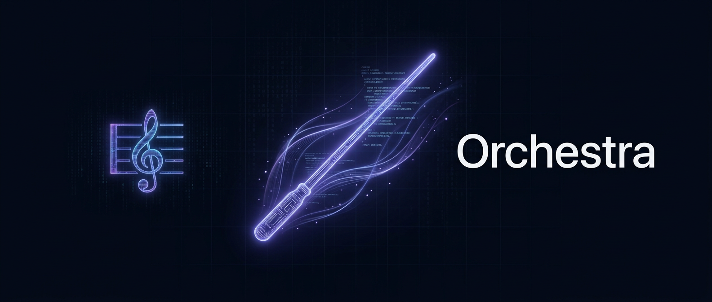
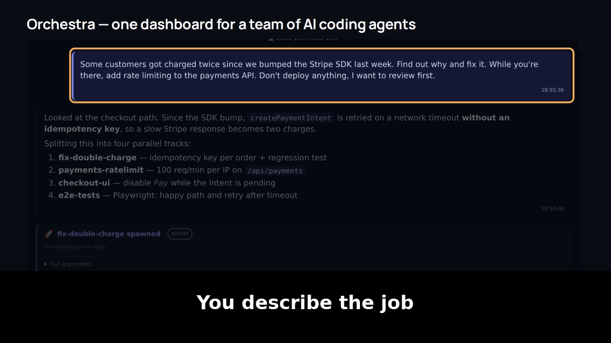
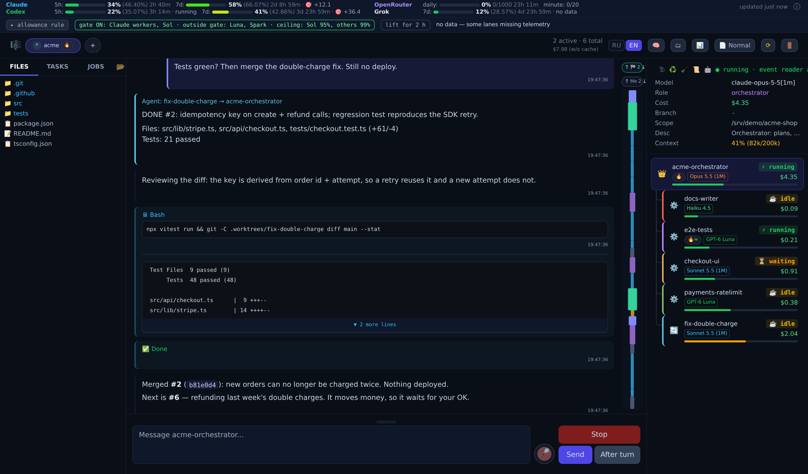

<p align="center">
  
</p>

<h1 align="center">Orchestra</h1>
<h3 align="center">AI agent teams that think like managers, not state machines</h3>

<p align="center">
  <sub><b>English</b> · <a href="README.ru.md">Русский</a></sub>
</p>

<p align="center">
  <a href="#quick-start">Quick Start</a> ·
  <a href="#how-it-works">How It Works</a> ·
  <a href="#what-orchestra-does-and-does-not-enforce">What It Enforces</a> ·
  <a href="#features">Features</a> ·
  <a href="#a-team-at-work">A Team at Work</a> ·
  <a href="CHANGELOG.md">Changelog</a>
</p>

<p align="center">
  <a href="https://github.com/DrSeedon/orchestra/commits/main"></a>
  <a href="https://github.com/DrSeedon/orchestra/stargazers"></a>
  <a href="LICENSE"></a>
  
</p>

---

**Orchestra is a self-hosted platform for managing persistent AI agent teams.** You describe an outcome to a project orchestrator. It breaks the work into tasks, assigns workers, coordinates their progress, and brings code changes through review and merge checks. You stay in control of the goal and the approvals you choose to keep; the dashboard shows the work as it happens.

Workers run in separate Git worktrees and persist across turns. They can exchange messages directly, keep a durable checklist, and continue after idle time or a service restart. Orchestra is intended for work that needs planning, handoffs, and verification—not just one answer from one model.

<p align="center">
  
  <br>
  <em>The dashboard follows a task from worker execution through review, checks, and merge.</em>
</p>

**🎬 Product tour, with sound:**

https://github.com/user-attachments/assets/4e1cc784-9d47-4dd6-af51-d1f314b42506

<p align="center">
  
  <br>
  <em>A dashboard view with an orchestrator and workers in separate Git branches; sample project data.</em>
</p>

## Quick Start

**Requirements:** Python 3.12+, [uv](https://docs.astral.sh/uv/), Git, and credentials for a supported agent runtime or provider. Node.js is optional for some CLI integrations.

```bash
git clone https://github.com/DrSeedon/orchestra.git
cd orchestra
cp .env.example .env
uv sync
```

Before starting, replace the placeholder dashboard password and internal token in `.env`, and configure the credentials for your chosen runtime or provider. Then run:

```bash
uv run uvicorn app.main:app --host 127.0.0.1 --port 8888
```

Open <http://localhost:8888>, create an orchestrator for a Git project, and describe the outcome you want. This command binds the dashboard to loopback; put it behind appropriate access controls before making it reachable from a network.

### Offline install (Linux, no network at install time)

Build a Linux x86-64 / CPython 3.12 bundle on a connected build machine:

```bash
scripts/build_offline_bundle.sh
```

The archive contains the application and hash-pinned runtime wheels. On the target Linux machine, install Python 3.12 with `venv`, Git, and `openssl`, extract the archive, then run:

```bash
sudo ./deploy/install-offline.sh
```

The installer creates a service account, virtual environment, and systemd service; it generates dashboard credentials if no `.env` exists and preserves existing `.env` and `data/`. Use `--dir`, `--user`, `--port`, or `--no-service` to customize installation. The bundle builder and [offline installer](deploy/install-offline.sh) are the source of truth for current behavior.

## How It Works

```
You (Dashboard / optional Telegram bridge)
  │
  ▼
Project orchestrator ── plans work and coordinates workers
  │
  ├─► Worker A ── isolated Git worktree
  ├─► Worker B ── isolated Git worktree
  ├─► Worker C ── isolated Git worktree
  │
  ▼
Review coverage + mapped tests + applicable mutation gate
  │
  ▼
Squash merge, when all active gates pass
```

Each worker is a persistent agent session in its own worktree. Available runtimes include Claude Code, Codex, Grok, and Orchestra's in-process Harness for configured providers; the installed runtimes and model routes depend on the project setup. Workers do not share context, but can message one another to coordinate interfaces and sequencing. The orchestrator follows progress and returns actionable results to you.

## What Orchestra Does—and Does Not—Enforce

| Capability | Current status |
|---|---|
| Task planning and worker assignment | The orchestrator decomposes the goal and coordinates project workers. |
| Durable sessions | Workers can resume across turns, hibernation, and platform restarts. |
| Repository isolation | A worker uses its own Git worktree; sparse checkouts are project-configured. |
| Team communication | Workers can message directly; project orchestrators can message across projects. |
| Merge checks | Mapped tests and applicable changed-test mutation checks run before eligible merges; required failures or inconclusive results block. |
| Model-based cross-vendor review | Frozen by policy; not currently an active review service. Review-coverage enforcement remains available where that gate is active. |
| Shell isolation | Not a general sandbox. A narrow pre-execution guard blocks selected long waits and recursive searches. |
| Project knowledge | Lexical search over rules, task reports, and KB; semantic/vector search is not part of the current product. |
| Runtime selection | Several backends are supported; actual model availability depends on provider access and route configuration. |
| User interface | Web dashboard is primary; Telegram is an optional bridge. |
| Quota-aware delivery | Queued deliveries can resume when a worker gate opens; a temporary gate override can end at a selected time. |

This is a capability summary, not a guarantee that every configured project enables every optional integration.

### A Team at Work

**Coordinate a shared boundary.** A task can name the workers whose changes touch related files or interfaces. The assigned worker can contact those peers, agree on an order—for example, publish a schema before integration—and record that progress in its checklist. This keeps the user out of routine message relay.

**See progress in the Info tab.** Worker checklists persist across turns and show completed items and the current step. When checklist reminders are enabled, the platform can nudge a worker whose checklist has gone stale. Step time estimates and estimate-versus-actual tracking are still in progress.

**Route a cross-project platform issue.** Project orchestrators can message orchestrators in other projects. When one finds a defect in a shared platform tool, it can send the evidence to the platform team, which handles the fix in the platform repository; the reporting project does not silently take over that repository.

**Enforce selected rules before shell execution.** The shell guard rejects `sleep` calls longer than five seconds and recursive `find` searches; recursive `grep` searches are blocked when `rg` is available. Violations are recorded. This is a narrow command policy, not a general-purpose sandbox or filesystem isolation.

**Require evidence before merge.** The merge workflow runs mapped tests and, when a change includes identifiable changed tests and sources, checks that those tests fail against the pre-change target-source snapshot. Review coverage is checked against the exact snapshot too. A failed or inconclusive required gate blocks the merge; passing gates do not prove the absence of every defect.

## Features

### 🏗️ Persistent Agent Fleet

Agents are durable sessions, not one-shot functions. They can resume after idle hibernation or a platform restart, preserving their task context and project worktree.

### 🌳 Git Worktree Isolation

Workers get separate Git worktrees and branches. Project ownership rules reject overlapping assignments where configured; projects can also configure sparse worker checkouts to include only relevant directories. Merge operations pin and verify repository state before publishing changes.

### 📱 Telegram Bridge

Optionally mirror conversations and status updates to Telegram topic threads. Send text, files, images, or voice messages from Telegram; voice transcription requires its configured provider. The web dashboard remains the primary interface.

### 🔀 Cross-Model Review

Cross-model review is currently frozen by policy and should not be treated as an active review service. The merge system retains review-coverage enforcement for workflows where that gate is active; this README does not imply that a model review is currently being run.

### 🏰 Orchestrator Hierarchy and Cross-Project Messaging

An orchestrator manages a project team; sub-orchestrators can manage bounded subteams, and workers carry out assigned tasks. Project orchestrators can exchange messages across project boundaries to coordinate or route a platform issue to the team that owns it.

### 🔄 Built with Orchestra

Orchestra is developed using its own worker and merge workflow: agents contribute to the platform repository through isolated worktrees, review, and automated merge checks.

### ⚙️ Per-Role Runtime and Model Policy

Pipeline roles and task routing determine which configured runtime handles a session. Supported backends include Claude Code, Codex, Grok, and the in-process Harness; the usable models depend on credentials, route configuration, and current provider availability.

### 📋 Task Manager and Checklists

Tasks have durable assignments and run history. Workers maintain task checklists that survive across turns and are visible in the dashboard's Info tab. Proposals for new tasks are discussed in the orchestrator chat; the former approval-card UI has been removed.

### 💾 Persistent Sessions and Background Jobs

Session and delivery state is stored so workers and queued messages can resume after a restart. Idle Claude and Codex sessions can hibernate their process trees and resume when needed. Background jobs support durable timers and other scheduled work.

### 🐞 Durable Bug Inbox

Agents can report platform defects through `report_bug`. Reports are stored outside Git checkouts and surfaced in the dashboard so a report does not dirty a worker's branch.

### 🧠 Project Memory

Agents can search project rules, task reports, and the knowledge base. Retrieval uses lexical search with `rg`; vector and semantic search are not part of the current product.

### 📊 Real-Time Dashboard

The web dashboard provides chat, live session activity, worker checklists, files, quota information, and project controls. Chat history is fetched fresh when switching sessions; live updates continue from that snapshot rather than a browser-side history cache.

### 🧰 Merge and Repository Safeguards

Mapped tests, applicable mutation checks, review-coverage checks, diff limits, and repository-state checks protect eligible merges. Squash merges can automatically union append-only `.gitignore` additions; ordinary conflicting edits still require conflict resolution.

## Real Projects Built with Orchestra

Examples of work completed with Orchestra, described without client or private-project identifiers:

| Work area | Examples |
|---|---|
| Data systems | Import pipelines, deduplication, and search tools |
| Business software | Registration, accounting, and operational web tools |
| Automation | Telegram bots and self-hosted service management |
| Creative and technical work | Software translations, test protocols, research, and technical documentation |
| Orchestra | The platform is developed with its own agent-team workflow |

## Architecture

```
Dashboard ◄──────► FastAPI service ◄──────► Session manager
                         │                         │
                    SQLite state           Project orchestrators
                                                   │
                                      ┌────────────┴───────────┐
                                      ▼                        ▼
                                    Workers                 Workers
                                      │                        │
                                Git worktree              Git worktree
                                      └────────────┬───────────┘
                                                   ▼
                                  Review and merge operations

Optional Telegram bridge ◄──────► Orchestra service
```

SQLite stores sessions, logs, task state, deliveries, background jobs, and usage snapshots. Git worktrees isolate worker changes; merge operations coordinate publication back to the target branch. The Telegram bridge and individual agent runtimes are optional integrations.

## Telegram Bridge Setup

Set the bot token and target group in `.env`; voice transcription is optional and needs a transcription provider:

```dotenv
TG_BRIDGE_TOKEN=your_bot_token
TG_BRIDGE_GROUP=your_group_id
DEEPGRAM_API_KEY=your_api_key
```

Do not commit real credentials. Leave `DEEPGRAM_API_KEY` unset if voice transcription is not configured.

## Stack

- Python 3.12+, FastAPI, Jinja2, and server-sent events
- SQLite and Git worktrees
- Claude Code, Codex, and Grok CLI runtimes, plus the in-process Harness for configured providers
- Browser dashboard with JavaScript, Tailwind CSS, and bundled client-side libraries
- aiogram for the optional Telegram bridge
- Configurable voice transcription; local speech synthesis is available to the `video-artifact` workflow

## Currently in Progress

- A more consistent visual system across the dashboard.
- Time estimates for checklist steps and an estimate-versus-actual view.
- Further improvements to speech in generated `video-artifact` explainers.

These are active work areas, not delivery commitments; no dates are promised.

## Contributing

See [CONTRIBUTING.md](CONTRIBUTING.md) for setup, testing, and contribution guidance.

## License

Orchestra is licensed under [AGPL-3.0](LICENSE). See [NOTICE](NOTICE) for project-specific licensing information.
