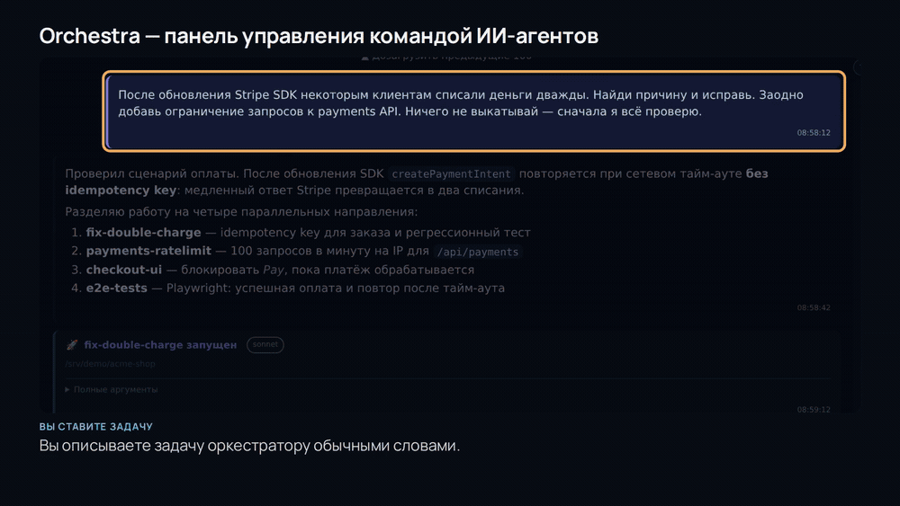
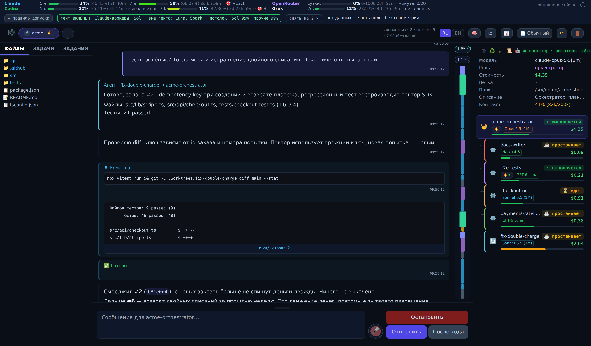

<p align="center">
  
</p>

<h1 align="center">Orchestra</h1>
<h3 align="center">Команды ИИ-агентов, которые думают как менеджеры, а не конечные автоматы</h3>

<p align="center">
  <sub><a href="README.md">English</a> · <b>Русский</b></sub>
</p>

<p align="center">
  <a href="#быстрый-старт">Быстрый старт</a> ·
  <a href="#как-это-работает">Как это работает</a> ·
  <a href="#что-orchestra-контролирует-и-чего-не-гарантирует">Что контролируется</a> ·
  <a href="#возможности">Возможности</a> ·
  <a href="#команда-в-работе">Команда в работе</a> ·
  <a href="CHANGELOG.md">Changelog</a>
</p>

<p align="center">
  <a href="https://github.com/DrSeedon/orchestra/commits/main"></a>
  <a href="https://github.com/DrSeedon/orchestra/stargazers"></a>
  <a href="LICENSE"></a>
  
</p>

---

**Orchestra — платформа с собственным хостингом для управления постоянными командами ИИ-агентов.** Вы описываете результат оркестратору проекта. Он разбивает работу на задачи, назначает воркеров, координирует их и проводит изменения кода через ревью и проверки перед слиянием. Вы задаёте цель и сохраняете нужные вам подтверждения, а в дашборде виден ход работы.

Воркеры работают в отдельных Git worktree и продолжают между ходами. Они могут напрямую обмениваться сообщениями, вести постоянный чеклист и продолжать после простоя или перезапуска сервиса. Orchestra рассчитана на задачи, которым нужны планирование, передача работы и проверка, а не только один ответ одной модели.

<p align="center">
  
  <br>
  <em>Дашборд показывает задачу от работы воркера до ревью, проверок и слияния.</em>
</p>

**🎬 Тур по продукту, со звуком:**

https://github.com/user-attachments/assets/19a92bef-1e04-4125-9163-ef3228c71cea

<p align="center">
  
  <br>
  <em>Демонстрационный вид дашборда с оркестратором и воркерами в отдельных Git-ветках.</em>
</p>

## Быстрый старт

**Нужно:** Python 3.12+, [uv](https://docs.astral.sh/uv/), Git и учётные данные поддерживаемого рантайма или провайдера. Node.js необязателен и нужен для некоторых CLI-интеграций.

```bash
git clone https://github.com/DrSeedon/orchestra.git
cd orchestra
cp .env.example .env
uv sync
```

Перед запуском замените шаблонные пароль дашборда и внутренний токен в `.env`, настройте учётные данные выбранного рантайма или провайдера. Затем запустите:

```bash
uv run uvicorn app.main:app --host 127.0.0.1 --port 8888
```

Откройте <http://localhost:8888>, создайте оркестратора для Git-проекта и опишите желаемый результат. Команда привязывает дашборд к loopback; перед открытием сетевого доступа настройте соответствующие средства контроля доступа.

### Офлайн-установка (Linux, без сети во время установки)

Соберите комплект для Linux x86-64 / CPython 3.12 на машине с доступом в сеть:

```bash
scripts/build_offline_bundle.sh
```

Архив содержит приложение и зависимости рантайма с закреплёнными хешами. На целевой машине Linux установите Python 3.12 с `venv`, Git и `openssl`, распакуйте архив и выполните:

```bash
sudo ./deploy/install-offline.sh
```

Установщик создаёт системного пользователя, виртуальное окружение и systemd-сервис; если `.env` отсутствует, он генерирует учётные данные дашборда, а существующие `.env` и `data/` сохраняет. Можно задать `--dir`, `--user`, `--port` или `--no-service`. Источник актуального поведения — сборщик комплекта и [офлайн-установщик](deploy/install-offline.sh).

## Как это работает

```
Вы (дашборд / необязательный мост Telegram)
  │
  ▼
Оркестратор проекта ── планирует и координирует работу
  │
  ├─► Воркер A ── изолированный Git worktree
  ├─► Воркер B ── изолированный Git worktree
  ├─► Воркер C ── изолированный Git worktree
  │
  ▼
Покрытие ревью + набор тестов + применимый мутационный гейт
  │
  ▼
Squash-слияние, если пройдены все активные гейты
```

Каждый воркер — постоянная агентская сессия в собственном worktree. Доступны рантаймы Claude Code, Codex, Grok и встроенный Harness Orchestra для настроенных провайдеров; набор моделей и рантаймов зависит от конфигурации проекта. У воркеров разный контекст, но они могут напрямую согласовывать интерфейсы и порядок работы. Оркестратор следит за прогрессом и возвращает вам результат.

## Что Orchestra контролирует и чего не гарантирует

| Возможность | Текущее состояние |
|---|---|
| Планирование и назначение задач | Оркестратор разбивает цель и координирует воркеров проекта. |
| Постоянные сессии | Воркеры могут продолжить работу после нескольких ходов, гибернации или перезапуска платформы. |
| Изоляция репозитория | У воркера собственный Git worktree; разреженные копии настраиваются для проекта. |
| Командная связь | Воркеры пишут друг другу; оркестраторы могут общаться между проектами. |
| Проверки перед слиянием | Перед подходящими слияниями выполняются сопоставленные тесты и применимые мутационные проверки изменённых тестов; обязательные ошибки и неопределённость блокируют слияние. |
| Межвендорное модельное ревью | Заморожено политикой и сейчас не является действующей услугой. Проверка покрытия ревью остаётся доступной в процессах, где включён этот гейт. |
| Изоляция shell | Это не универсальная песочница. Узкий гейт до запуска блокирует выбранные долгие ожидания и рекурсивные поиски. |
| Знания проекта | Лексический поиск по правилам, отчётам задач и базе знаний; семантический/векторный поиск сейчас не входит в продукт. |
| Выбор рантайма | Поддерживается несколько бэкендов; доступность моделей зависит от провайдера и настроек маршрута. |
| Интерфейс | Основной интерфейс — веб-дашборд; Telegram подключается по желанию. |
| Доставка с учётом квот | Ожидающие доставки продолжаются после открытия квотного гейта; временное снятие гейта можно завершить в выбранное время. |

Это сводка возможностей, а не гарантия, что в каждом проекте включены все необязательные интеграции.

## Команда в работе

**Согласование общей границы.** В задаче можно назвать коллег, чьи изменения связаны общими файлами или интерфейсами. Воркер может написать им и согласовать порядок — например, сначала описать готовую схему, а затем перейти к интеграции. Этот шаг можно отразить в чеклисте, не заставляя пользователя передавать сообщения вручную.

**Прогресс во вкладке Info.** Чеклист воркера сохраняется между ходами и показывает сделанное и текущий шаг. Если включены напоминания, платформа может подтолкнуть воркера обновить устаревший чеклист. Оценки времени по шагам и сравнение оценки с фактом пока в работе.

**Проблема платформы найдена в другом проекте.** Оркестраторы проектов могут писать друг другу. Если один из них обнаружил дефект общего инструмента, он может передать доказательства команде платформы; исправление в репозитории платформы делает команда, которая его сопровождает. Проект, где нашли проблему, не получает молча права менять чужой репозиторий.

**Выбранные правила проверяются до запуска shell-команды.** Shell-гейт отклоняет `sleep` дольше пяти секунд и рекурсивный поиск `find`; рекурсивный `grep` блокируется, когда доступен `rg`. Нарушения записываются. Это узкая политика команд, а не универсальная песочница или изоляция файловой системы.

**Перед слиянием требуются проверяемые основания.** Гейт запускает сопоставленные тесты и, когда в изменении есть распознаваемые изменённые тесты и исходники, проверяет, что эти тесты падают на снимке целевых исходников до изменений. Покрытие ревью также сверяется с точным снимком. Ошибка или неопределённый результат обязательной проверки блокируют слияние; успешные гейты не доказывают отсутствие любых дефектов.

## Возможности

### 🏗️ Постоянный парк агентов

Агенты — долговечные сессии, а не одноразовые функции. Они могут возобновиться после гибернации или перезапуска платформы, сохраняя контекст задачи и worktree.

### 🌳 Изоляция через Git worktree

Воркеры получают отдельные Git worktree и ветки. Настроенные в проекте правила владения отклоняют пересекающиеся назначения; проект также может ограничить рабочую копию воркера нужными каталогами. Операции слияния фиксируют и проверяют состояние репозитория перед публикацией изменений.

### 📱 Мост в Telegram

При желании переписку и статусы можно зеркалировать в топики Telegram. Через Telegram можно отправлять текст, файлы, изображения и голосовые сообщения; для расшифровки нужен настроенный провайдер. Основной интерфейс — веб-дашборд.

### 🔀 Межмодельное ревью

Сейчас межмодельное ревью заморожено политикой и не является действующей услугой проверки. В системе слияния сохранена проверка покрытия ревью для тех процессов, где этот гейт включён; README не утверждает, что модельное ревью сейчас запускается.

### 🏰 Иерархия оркестраторов и межпроектные сообщения

Оркестратор управляет командой проекта; суб-оркестраторы могут вести ограниченные подкоманды, а воркеры выполняют назначенные задачи. Оркестраторы проектов могут обмениваться сообщениями через границы проектов, чтобы согласовать работу или передать платформенную проблему команде-владельцу инструмента.

### 🔄 Orchestra разрабатывается с помощью Orchestra

Агенты участвуют в разработке самой платформы по тому же процессу: изолированные worktree, ревью и автоматические проверки перед слиянием.

### ⚙️ Рантаймы и политика моделей по ролям

Рантайм сессии определяют роль в pipeline и правила маршрутизации задачи. Поддерживаются Claude Code, Codex, Grok и встроенный Harness; доступность конкретной модели зависит от учётных данных, настроек маршрута и провайдера.

### 📋 Менеджер задач и чеклисты

У задач есть постоянные назначения и история запусков. Воркеры ведут чеклисты, которые сохраняются между ходами и отображаются во вкладке Info дашборда. Предложения новых задач обсуждаются в чате оркестратора; прежние карточки согласования удалены.

### 💾 Постоянные сессии и фоновые задания

Состояния сессий и доставок сохраняются, чтобы воркеры и сообщения в очереди могли продолжиться после перезапуска. Простаивающие сессии Claude и Codex могут усыплять дерево процессов и возобновляться при необходимости. Фоновые задания поддерживают постоянные таймеры и другие запланированные запуски.

### 🐞 Надёжный инбокс багов

Агенты могут сообщать о дефектах платформы через `report_bug`. Отчёты хранятся вне Git worktree и показываются в дашборде, не загрязняя ветку воркера.

### 🧠 Память проекта

Агенты ищут правила проекта, отчёты задач и базу знаний. Используется лексический поиск через `rg`; векторный и семантический поиск не входят в текущий продукт.

### 📊 Дашборд в реальном времени

Веб-дашборд объединяет чат, текущую активность сессий, чеклисты воркеров, файлы, квоты и управление проектом. При переключении сессии история загружается заново; поток новых событий продолжается от этого снимка, а не из локального кеша истории браузера.

### 🧰 Гейты слияния и защита репозитория

Перед подходящим слиянием проверяются сопоставленные тесты, применимые мутационные проверки, покрытие ревью, лимит diff и состояние репозитория. При squash-слиянии совместимые добавления в конец `.gitignore` автоматически объединяются; обычные конфликты требуют разрешения.

## Примеры проектов на Orchestra

Примеры выполненной работы без названий клиентов и частных проектов:

| Область | Примеры |
|---|---|
| Данные | Конвейеры импорта, дедупликация и поисковые инструменты |
| Бизнес-системы | Регистрация, бухгалтерия и операционные веб-инструменты |
| Автоматизация | Telegram-боты и управление собственными сервисами |
| Творческая и техническая работа | Переводы ПО, протоколы испытаний, исследования и техническая документация |
| Orchestra | Платформа развивается с помощью собственного процесса работы команд агентов |

## Архитектура

```
Дашборд ◄────────► FastAPI-сервис ◄────────► Менеджер сессий
                         │                         │
                    Состояние SQLite       Оркестраторы проектов
                                                   │
                                      ┌────────────┴───────────┐
                                      ▼                        ▼
                                   Воркеры                  Воркеры
                                      │                        │
                                Git worktree              Git worktree
                                      └────────────┬───────────┘
                                                   ▼
                                  Ревью и операции слияния

Необязательный мост Telegram ◄────► Сервис Orchestra
```

SQLite хранит сессии, логи, состояние задач, доставки, фоновые задания и снимки использования. Git worktree изолируют изменения воркеров; операции слияния управляют публикацией в целевую ветку. Мост Telegram и отдельные рантаймы — необязательные интеграции.

## Настройка моста Telegram

Укажите токен бота и целевую группу в `.env`. Голосовая расшифровка необязательна и требует провайдера:

```dotenv
TG_BRIDGE_TOKEN=your_bot_token
TG_BRIDGE_GROUP=your_group_id
DEEPGRAM_API_KEY=your_api_key
```

Не коммитьте реальные учётные данные. Если расшифровка голосовых не настроена, оставьте `DEEPGRAM_API_KEY` пустым.

## Стек

- Python 3.12+, FastAPI, Jinja2 и server-sent events
- SQLite и Git worktree
- CLI-рантаймы Claude Code, Codex и Grok, а также встроенный Harness для настроенных провайдеров
- Браузерный интерфейс на JavaScript, Tailwind CSS и встроенных клиентских библиотеках
- aiogram для необязательного моста Telegram
- Настраиваемая голосовая расшифровка; локальный синтез речи доступен для сценария `video-artifact`

## Сейчас в работе

- Единая визуальная система дашборда.
- Оценки времени для шагов чеклиста и сравнение оценки с фактом.
- Дальнейшие улучшения озвучки объяснений `video-artifact`.

Это направления текущей работы, а не обещания сроков.

## Участие в разработке

Инструкции по настройке, тестированию и отправке изменений приведены в [CONTRIBUTING.md](CONTRIBUTING.md).

## Лицензия

Orchestra распространяется по лицензии [AGPL-3.0](LICENSE). Дополнительная информация о лицензировании проекта приведена в [NOTICE](NOTICE).
